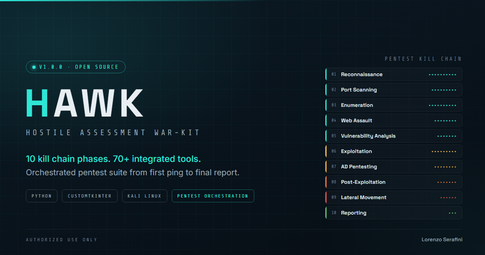
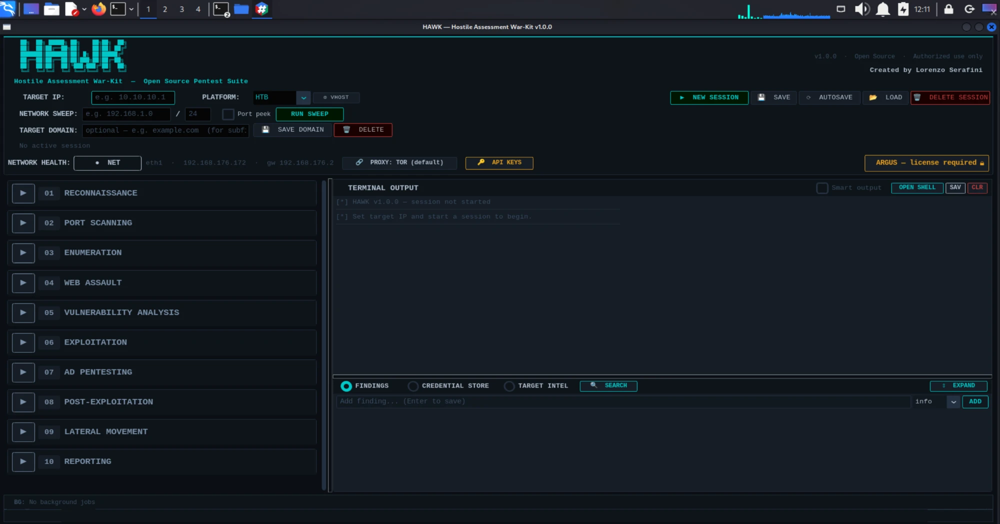
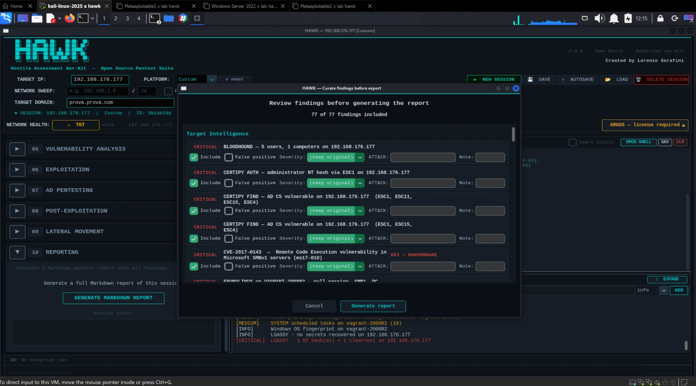

# HAWK — Hostile Assessment War-Kit

<p align="center">
  
</p>

HAWK is a portable, Kali-oriented **penetration-testing GUI**. It organises an
engagement around a ten-phase kill-chain — from reconnaissance to reporting —
with a live **Target Intelligence** panel that turns raw tool output into
structured, actionable findings.

It runs fully offline: no cloud, no telemetry, no AI inside the app. You copy the
folder onto Kali and run it.

> ⚠️ **Authorized use only.** HAWK is for security professionals performing
> **authorized** penetration testing and security research, and for learning on
> systems you own or have explicit written permission to test (lab VMs, CTFs,
> Hack The Box, and similar). Using it against systems without authorization is
> illegal and unethical. You are solely responsible for your actions and for
> complying with all applicable laws. The author accepts no liability for misuse.

## What it does

A NETWORK/HOST kill-chain, one card column per phase:

- **Reconnaissance** — ping, traceroute, whois, DNS, subdomain/OSINT
- **Scanning** — nmap (profiles), masscan, rustscan
- **Enumeration** — SMB, LDAP, RPC, SNMP, web content discovery, DB fingerprinting
- **Web assault** — web profiler, crawler, injection, JWT analysis
- **Vulnerability analysis** — nikto, nuclei, sqlmap, wpscan, OpenVAS/Greenbone
- **Exploitation** — Metasploit, Hydra/ncrack, Responder, impacket
- **AD pentesting** — BloodHound, kerberoast/AS-REP, certipy (AD CS / ESC), DCSync, delegation
- **Post-exploitation** — LinPEAS/winPEAS funnels, privilege-escalation cheat-sheets
- **Lateral movement** — impacket exec, ligolo-ng/chisel/sshuttle, RDP, SOCKS
- **Reporting** — one-click deliverable (HTML/CSV/Markdown, optional PDF)

The **Target Intel** panel correlates findings to CWE / OWASP / CVSS / CISA-KEV /
MITRE ATT&CK, tracks recovered credentials, and feeds the report engine.

HAWK **wraps** the standard open-source tools (nmap, impacket, nuclei, …): it
orchestrates the workflow and produces the reporting — it does not reimplement
the tools themselves.

HAWK is a **kill-chain orchestrator**, not an exploitation framework. Its
value is in structuring the engagement: turning attack surface into actionable
findings, and driving the credential and Active Directory lifecycle
(dump → Credential Store → crack → lateral movement) through to the
report. Gaining the initial foothold — the exploit itself, or social
engineering — is left to the wrapped tools and to the operator. HAWK is
strongest in enumeration, web testing, and post-exploitation / AD.

## Screenshots

The ten-phase kill-chain console — session not started:



Curating Target Intelligence findings before generating the report:



## Run

Clone the repo onto Kali, do the one-time setup (Tk runtime + virtualenv — see
**Python dependencies** below for why), and launch with the venv's interpreter:

```bash
git clone https://github.com/serafinilorenzo87-png/hawk.git
cd hawk
sudo apt update
sudo apt install -y python3-tk python3-venv
python3 -m venv venv
./venv/bin/python3 -m pip install -r requirements.txt
./venv/bin/python3 hawk.py
```

HAWK is intentionally self-contained. Persistent files generated by the
application stay inside this folder:

- `sessions/` for saved sessions and local API key storage
- `outputs/` for reports, dumps, exports, and tool output
- `dicts/` for generated wordlists
- `tmp/` for temporary app files
- `cache/` for local indexes/cache
- `logs/` for optional diagnostic logs
- `configs/` for app-generated config snippets

The only expected external persistent change is explicit system integration,
such as HAWK-marked temporary entries in `/etc/hosts`.

## Python dependencies

HAWK's Python packages go in a **virtualenv**, so they stay isolated from Kali's
system Python — several offensive tools (impacket, netexec, …) run on the system
interpreter, and Kali 2025 blocks a direct `pip` (PEP 668). Tk itself is a
**system** package (`python3-tk`), not a pip one — `pip install tkinter` does
not exist; a venv inherits tkinter from the system Python.

```bash
sudo apt update
sudo apt install -y python3-tk python3-venv
python3 -m venv venv
./venv/bin/python3 -m pip install -r requirements.txt
```

Then run with `./venv/bin/python3 hawk.py` (or `source venv/bin/activate` once,
then `python3 hawk.py`). `python3 -m venv venv` prints nothing when it succeeds —
that is expected. A simpler but non-isolated alternative that installs
into the system Python (`--break-system-packages`) is documented in
[`USAGE.md`](USAGE.md).

The report engine produces a self-contained HTML deliverable (plus CSV and
Markdown) with no extra dependencies. PDF export is an **optional** enhancement:
if [WeasyPrint](https://weasyprint.org/) and its native libraries are installed,
HAWK also writes a `.pdf` rendered from the same HTML. WeasyPrint is **not** in
`requirements.txt` (it pulls native libs and would break the copy-and-run
portability) — without it, simply open the HTML and print to PDF from your
browser.

## Requirements

- Developed and tested on **Kali GNU/Linux 2025.1** (rolling), kernel 6.12.x.
- The Kali/system tools HAWK drives (nmap, impacket, nuclei, hydra, netexec,
  responder, bloodhound, certipy, ligolo-ng, chisel, …) come from the Kali
  repositories and are documented in [`docs/kali-setup.md`](docs/kali-setup.md).
  HAWK installs most of these on demand from the cards (RUN / INSTALL), and the
  first-run dialog offers the one-time nmap capabilities setup; the base
  environment (venv + system packages) is set up from the documented steps below
  and in [`USAGE.md`](USAGE.md). The commands stay visible, so you can review
  them before they run.

## Notes

- Run from the `hawk` directory with `./venv/bin/python3 hawk.py` (see
  **Python dependencies** for the one-time setup).
- Do not commit runtime data from `sessions/`, `outputs/`, `dicts/`, `tmp/`,
  `cache/`, `logs/`, or `configs/`.
- API keys are stored locally under `sessions/.apikeys.json` with restrictive
  permissions where the platform supports them.

## License

HAWK is released under the **Apache License 2.0** — see [`LICENSE`](LICENSE).

Per the [`NOTICE`](NOTICE) file (Apache 2.0 §4(d)), the attribution
**"Created by Lorenzo Serafini"** must be preserved in redistributions and
derivative works. Within those terms you are free to use, modify, fork and
redistribute HAWK.

## Author

Created by **Lorenzo Serafini**.
